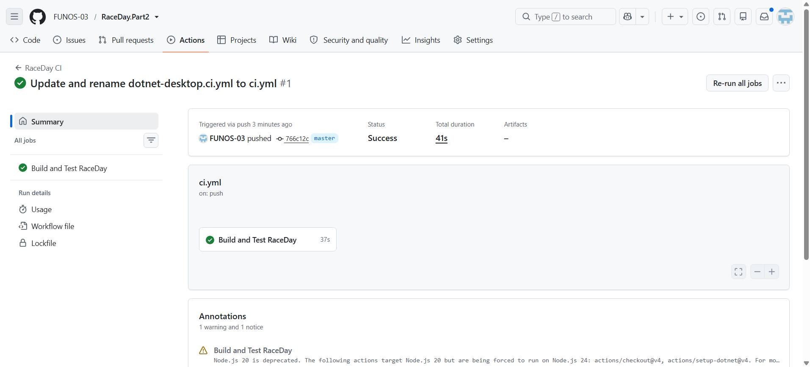

# RaceDay Part 2

## Project Overview
RaceDay is a web-based API designed to handle information and activities related to races. The application offers features for user sign-up, identity verification, participant profiles, races, divisions, events, registrations, and performance outcomes.

This application was built utilizing ASP.NET Core Web API and the .NET 8 framework.

## Technology Stack

- C#
- ASP.NET Core Web API
- .NET 8
- Entity Framework Core
- SQL Server Express
- SQL Server Management Studio (SSMS)
- JWT (JSON Web Token) for secure authentication
- Swagger / OpenAPI documentation
- xUnit for automated testing
- GitHub Actions for Continuous Integration (CI)

## Project Layout

- `RaceDay/` - Primary API codebase.
- `RaceDay.Tests/` - Automated test suite.
- `.github/workflows/ci.yml` - GitHub Actions build and test configuration.
- `RaceDay.Part2.sln` - Visual Studio solution file.

## System Requirements

To execute the application locally, ensure the following are installed:

- .NET 8 SDK
- Visual Studio 2022 or an equivalent Integrated Development Environment (IDE)
- SQL Server Express
- SQL Server Management Studio (SSMS)

## Database Configuration

The system utilizes SQL Server Express with a database designated as `RaceDay`.

The default connection string is configured as follows:

`Server=.\SQLEXPRESS;Database=RaceDay;Integrated Security=True;TrustServerCertificate=True;`

Please verify that your SQL Server Express instance is active and properly configured prior to launching the API.

## How to Run the Application

1. Download or clone this repository to your local machine.
2. Launch the `RaceDay.Part2.sln` file in Visual Studio.
3. Restore the required NuGet packages.
4. Verify that the database connection string is properly set.
5. Compile the solution.
6. Start the `RaceDay` API project.
7. Access the Swagger UI via the provided URL to view and test the available API endpoints.

## Authentication

The application handles user registration and sign-in processes through JWT authentication.

Upon successful authentication, use the generated token to access restricted endpoints. Within Swagger, click the **Authorize** button and input the token according to the specified format.

## Automated Testing

The `RaceDay.Tests` project includes automated test cases covering various features, such as:

- New user registration
- Handling of duplicate email addresses
- User login with correct and incorrect credentials
- Access control for restricted profile routes
- Verification of user roles

To execute these tests from the root directory of the solution, run the following command:

`dotnet test RaceDay.Part2.sln`

## Continuous Integration

A GitHub Actions workflow automatically restores packages, builds the application, and runs the test suite whenever code is pushed or a pull request is submitted to the `master` branch.

The workflow configuration file is located at:

`.github/workflows/ci.yml`
## Author

Created for the RaceDay Part 2 project.
## GitHub Actions Verification

The RaceDay CI process finished successfully. The outcomes of the automated build and execution tests are presented below.

